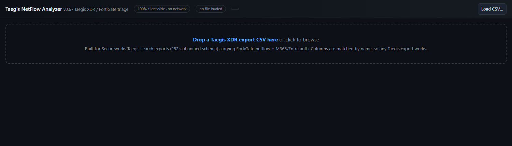
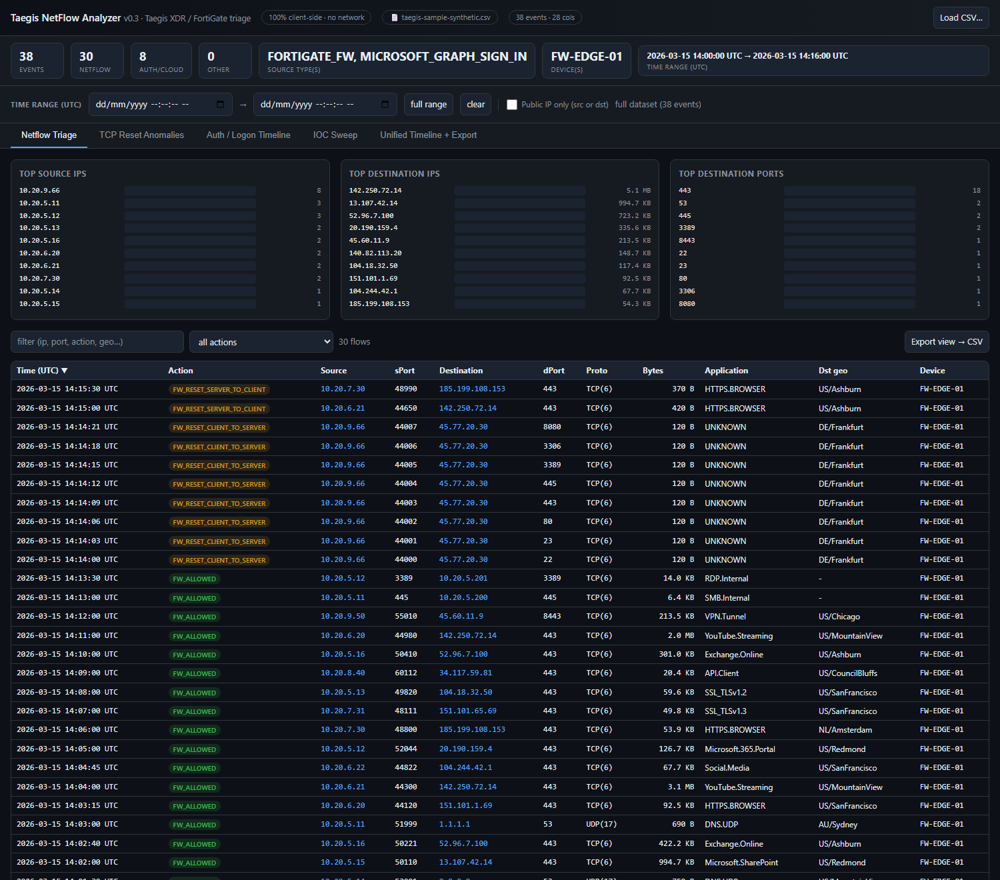
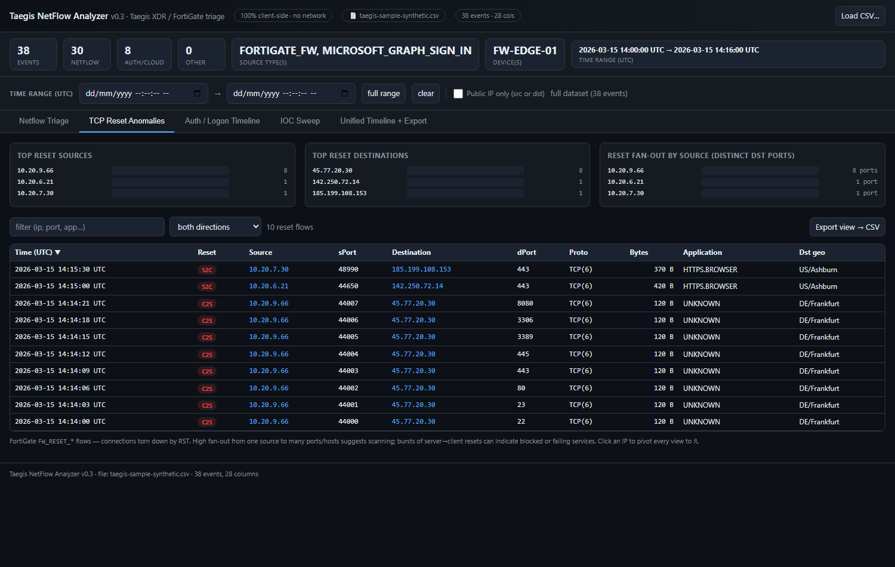
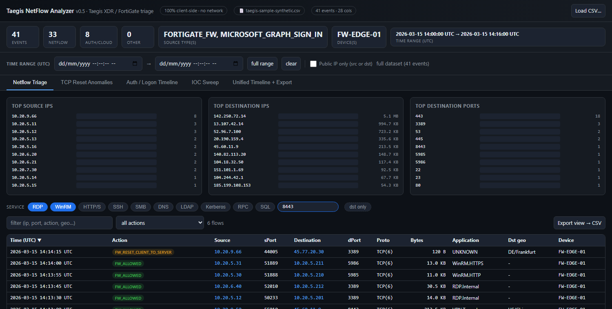

# Taegis NetFlow Analyzer

**Current build:** `Taegis-NetFlow-Analyzer-v0.6.5.html` (v0.6.5)

A single-file, **100% client-side** HTML tool for triaging **Secureworks Taegis XDR**
search exports — the 252-column normalized event schema that carries FortiGate
netflow, Microsoft 365 / Entra ID sign-ins, and other telemetry in one CSV.

No install, no server, no network calls. Open the HTML file in any browser and
drag a CSV onto it. Built for DFIR/IR workflows where evidence must never leave
the analyst's machine.

> **Important:** This tool contains no case data. Do **not** commit forensic
> exports (CSV/EVTX/PCAP/etc.) to this repo — the included `.gitignore` blocks
> common evidence file types as a guardrail.

## Screenshots

_All screenshots use the fully synthetic sample in [`sample/`](sample/) — every IP, user, and hostname is fabricated._

**Opening screen** — drag-and-drop a Taegis export:



**Netflow triage** — top talkers, bytes, ports, plus a filterable flow table with per-flow Service tags and Dst ASN / Country-City columns (headers are drag-resizable):



**TCP reset anomalies** — `FW_RESET_*` flows with a per-source fan-out heuristic (here `10.20.9.66` hits 8 distinct ports — a scanning pattern):



**Service quick-filters** — one-click chips (RDP + WinRM active here, plus custom port `8443`) narrow the flow table to remote-access / lateral-movement ports; the `dst only` toggle restricts matching to destination ports:



## Features

- **Global time-range filter (UTC)** — a `From → To` range at the top filters
  **every** view at once. `datetime-local` inputs are interpreted as **UTC** to
  match the displayed event times; a **full range** button auto-fills the
  dataset's bounds. The boxes hold whole seconds, and the `To` bound covers all
  of its second (`01:00:01` includes events up to `01:00:01.999`).
- **Public IP only (src or dst)** — a global checkbox that, when ticked, keeps
  only rows where the source or destination is a routable public address.
  Applies to every view.
  - IPv4: RFC1918, loopback, link-local (169.254/16), CGNAT (100.64/10),
    documentation, multicast, and reserved ranges are non-public.
  - IPv6: the address must parse, then is classified by range. Unspecified,
    loopback, link-local (`fe80::/10`), site-local (`fec0::/10`), unique-local
    (`fc00::/7`), multicast (`ff00::/8`), documentation (`2001:db8::/32`,
    `3fff::/20`) and discard-only (`100::/64`) are non-public. Addresses that
    embed an IPv4 address (`::ffff:a.b.c.d`, `::a.b.c.d`, NAT64 `64:ff9b::/96`)
    follow the IPv4 rules. Any other valid address counts as public.
- **Netflow triage** — top source/destination IPs, top destination IPs by bytes,
  top destination ports, with action / protocol / application columns and a
  filterable, sortable flow table.
- **Resizable columns** — drag the right edge of any column header; widths
  persist per view across sorting and filtering.
- **Service identification tags** — each flow with a recognized port gets a
  label (RDP, WinRM, HTTP/S, SSH, SMB, DNS, LDAP, Kerberos, RPC, SQL, plus
  FTP, Telnet, SMTP, POP3, IMAP, NTP, SNMP, Syslog, VNC, ADWS) shown in a
  **Service** column on the Netflow, Reset, IOC, and Timeline tables.
- **Geo breakout** — the Taegis `dest_ipgeo_summary` JSON is parsed into
  dedicated **Dst ASN** (org + AS number) and **Dst Ctry/City** columns; the
  raw geo blob is kept as the right-most column. Both are searchable via the
  free-text filter (e.g. type `Dropbox` or `DE / Frankfurt`) and included in
  CSV exports.
- **Service quick-filter chips** — one-click toggles on the Netflow, TCP-Reset,
  **and Unified Timeline** views that narrow the table to well-known service ports
  (multiple chips OR together): **RDP** (3389), **WinRM** (5985/5986),
  **HTTP/S** (80/443/8080/8443/8000), **SSH** (22), **SMB** (445/139), **DNS** (53),
  **LDAP** (389/636/3268/3269), **Kerberos** (88), **RPC** (135), **SQL**
  (1433/3306/5432/1521). Great for hunting remote-access and lateral movement.
  - **Custom ports** — a free-text box next to the chips accepts arbitrary ports
    (comma/space separated, e.g. `4444 8081`) and ORs them with the active chips.
  - **`dst only` toggle** — by default a chip matches source **or** destination
    port; switch it on for strict "connections **to** the service" semantics
    (destination port only).
  - On the Unified Timeline, events without ports (auth / cloudaudit) are hidden
    while a service filter is active.
- **TCP reset anomalies** — isolates FortiGate `FW_RESET_*` flows (connections
  torn down by RST), with top reset sources/destinations, a **fan-out heuristic**
  (distinct destination ports per source — a scanning indicator), and a
  direction filter (client→server / server→client resets).
- **Auth / logon timeline** — `auth` + `cloudaudit` events (M365 / Entra sign-ins)
  with user, source IP, result, **MFA result**, and application. When
  `mfa_result` is empty on a sign-in event, `mfa_used` = `true` / `false` is
  shown (and exported) as `MFA_USED` / `MFA_NOT_USED`; if both are absent the
  MFA cell stays empty.
- **Text filters** — each view's filter box searches every text column that
  view displays (including the Service tag, application, device, and MFA).
- **IOC sweep** — paste or load a list of IPv4 / IPv6 addresses, IPv4 CIDRs,
  domains, or URLs; matched events are highlighted across every view
  (CIDR-aware matching).
  - Defanged indicators (`1.2.3[.]4`, `evil[.]com`, `hxxp://…`) are understood,
    and a URL is reduced to its host. Anything after `#` on a line is a comment.
  - Addresses are checked against the source, destination, NAT, and
    `additional_*_addresses` columns; domains against every populated domain
    column (`domain_name`, `source_domain_name`, `target_domain_name`,
    `dns_name`) and `additional_domain_names`, not only the one displayed.
  - Domain matching ignores case and a trailing root dot (`evil.example.`).
    JSON arrays in the `additional_*` columns are decoded first, so an escaped
    value such as `["evil.example"]` matches like the plain one.
  - A sweep (or clearing the list) refreshes the highlighting on every table.
  - Tokens that are not an address or hostname (hashes, e-mail addresses, stray
    words) are skipped and reported as "ignored" next to the parsed counts.
    IPv6 CIDRs are not supported.
  - Dropping a file on the IOC tab loads it as an IOC list. The list is kept
    and re-swept when another export is loaded.
- **Exact IP pivot** — clicking an IP, or typing a complete address into a filter
  box, matches that exact source / destination address (`10.0.44.6` does not
  match `10.0.44.65`). Partial text is still a substring match.
- **Unified timeline + export** — all event types merged on one UTC timeline with
  free-text filtering, CSV export of the current view (named after the loaded
  file), and a "copy for case notes" button.
  - Exports and "copy for case notes" contain exactly the rows the table shows,
    in the table's current sort order (case notes take the first 500).
  - Every export has the same columns; `application`, `mfa` and `auth_detail`
    are the last three.
  - Cells that a spreadsheet would run as a formula (starting with `=`, `+`,
    `-`, or `@`) are exported with a leading apostrophe, because log fields are
    attacker-influenced. Strip it if you need the byte-exact value.

The loaded CSV's filename and the tool name/version are shown in the header and
footer of the page.

## Usage

1. Open `Taegis-NetFlow-Analyzer-v0.6.5.html` in a browser (double-click), or grab
   it from the [Releases](../../releases/latest) page.
2. Drag a Taegis XDR export CSV onto the drop zone (or click **Load CSV…**).
3. Use the tabs to triage. Click any IP to filter all views to it. Set a
   **Time range (UTC)** at the top to scope every view to a window.

Want to try it without real data? Load the included
[`sample/taegis-sample-synthetic.csv`](sample/taegis-sample-synthetic.csv) — a
small, fully fabricated dataset (netflow, a reset "scan", and M365 sign-ins).

## Why a dedicated parser

Two characteristics of Taegis exports break naive CSV handling (Excel, simple
comma-splitting):

- **Embedded JSON** — several columns (`original_data`, `ingest`, `*_ipgeo_summary`,
  `event_metadata`, …) contain JSON with commas and quotes. The tool uses a proper
  RFC-4180 parser that respects quoted fields, `""` escapes, and embedded newlines.
- **Size** — raw-log columns like `original_data` make exports big fast (a 100k-row
  Check Point netflow export is ~300 MB). Since v0.6.1 the parser slices fields out
  of the text instead of building them a character at a time, so files of that size
  load instead of exhausting the tab's memory. Since v0.6.3 it also skips the
  columns the analyzer never reads (most of the JSON blobs) and does not keep the
  raw rows, which cut the memory held for that export from about 340 MB to about
  40 MB at a similar load time (about 3 s to parse and build the records,
  measured in Node). The header shows read / parse progress and the file size.
  The practical ceiling is the browser's ~500 MB string limit; past that, narrow
  the Taegis search time range and re-export.
- **Damaged or foreign files are rejected** — a file that ends inside a quoted
  field (a truncated download), or whose header has no `type` column or no
  event-time column, is refused with a message instead of being loaded as a
  short or blank dataset. The dataset already on screen is kept.
- **`*_usec` columns are ISO-8601 strings** — despite the `_usec` suffix,
  `event_time_usec`, `start_timestamp_usec`, etc. hold strings like
  `2026-06-21T09:59:57Z`, not microsecond integers. The parser handles both forms;
  for raw epoch integers the unit (s / ms / µs / ns) is inferred from the magnitude.

Columns are resolved **by header name**, so the tool works on any Taegis XDR
search export, not just netflow/VPN pivots.

## Field mapping notes

| Concept | Taegis column(s) used |
|---|---|
| Event time | `event_time_usec` → `start_timestamp_usec` → `created_time_usec` → … |
| Event class | `type` (`netflow` / `auth` / `cloudaudit` / …) |
| Netflow action | `flow_action` (e.g. `FW_ALLOWED`, `FW_RESET_*`) |
| Source / dest | `source_address` / `destination_address` (+ `source_nat_address` for public NAT) |
| Bytes / packets | `tx_byte_count` + `rx_byte_count` / `tx_packet_count` + `rx_packet_count` |
| Device / sensor | `sensor_id`, `sensor_type` |
| Auth user | `user_name` → `target_user_name` → `extra_userprincipalname` → … |
| MFA | `mfa_result`, `mfa_used` |
| Dst geo | `dest_ipgeo_summary` (JSON → ASN org + number, `country.iso_code`, `city.name`) |

## Tests

Browser regression tests live in [`tests/`](tests/). They use fabricated data only
and need nothing but Node.js to serve the files:

```sh
node tests/serve.js     # then open http://127.0.0.1:8765/tests/run.html
```

See [`tests/README.md`](tests/README.md) for what is covered. Run them before
cutting a release.

## Releasing

Releases attach the standalone HTML file so it can be downloaded without cloning.
Cut a new one with the helper:

```sh
./release.sh v0.4                 # auto-picks the newest Taegis-NetFlow-Analyzer-*.html
./release.sh v0.4 path/to.html    # or name the asset explicitly
```

Equivalent manual command:

```sh
gh release create v0.4 Taegis-NetFlow-Analyzer-v0.4.html \
  --title "Taegis NetFlow Analyzer v0.4" --notes "…"
```

Downloads live at `https://github.com/bpmorris22/taegis-xdr-analyzer/releases/latest`.

## License

MIT — see [LICENSE](LICENSE).
